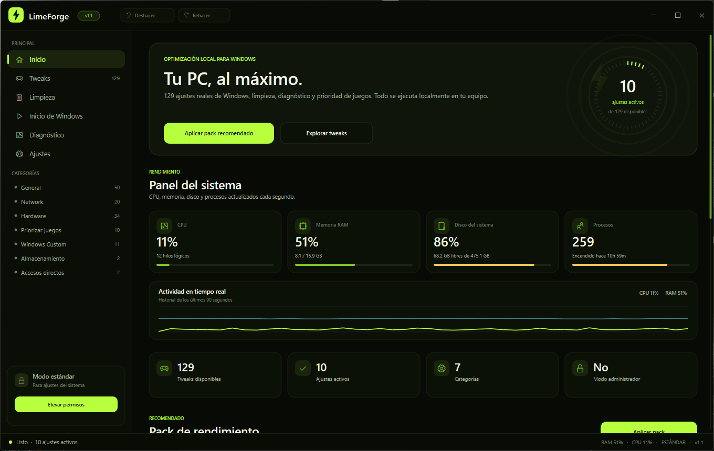
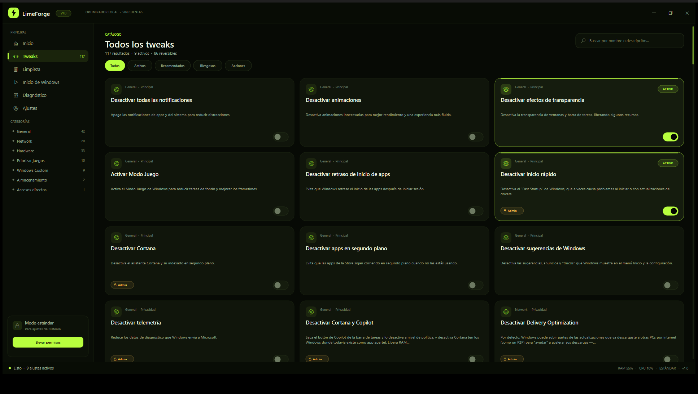
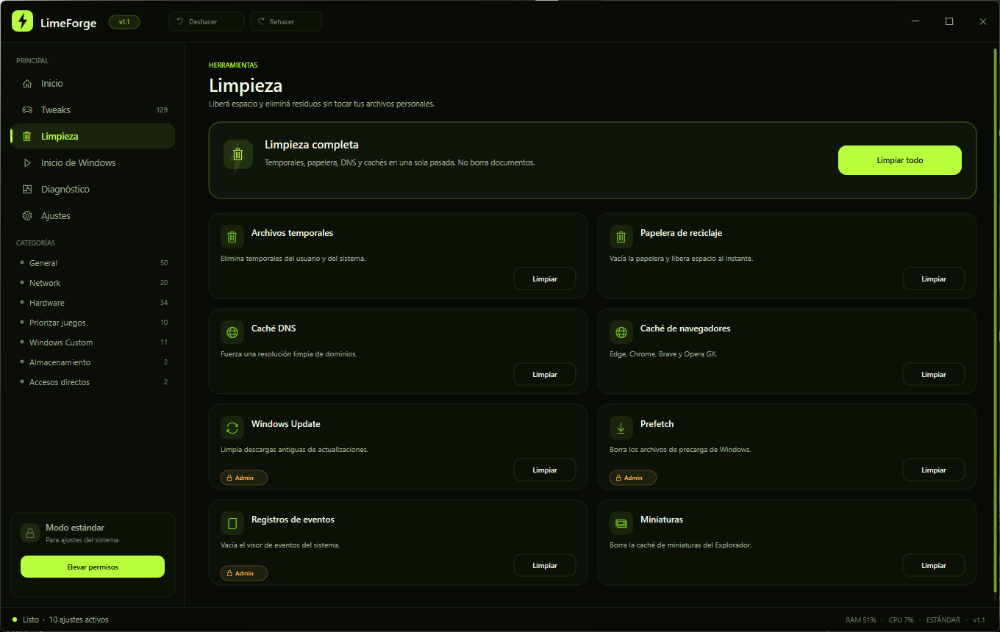
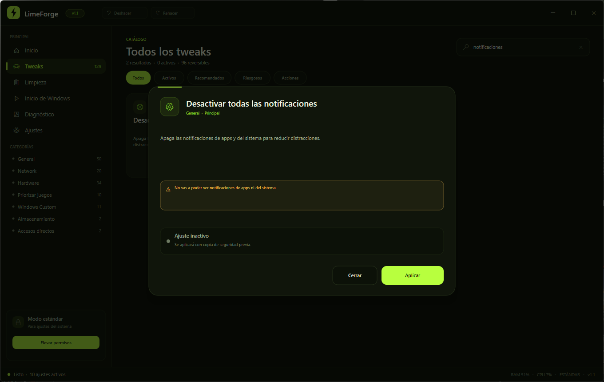
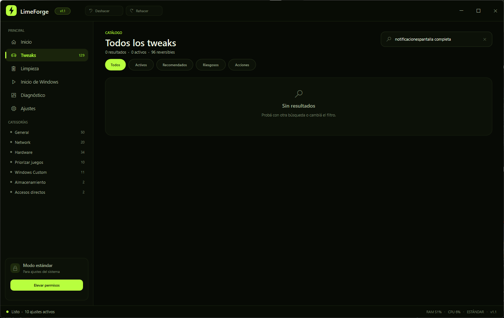
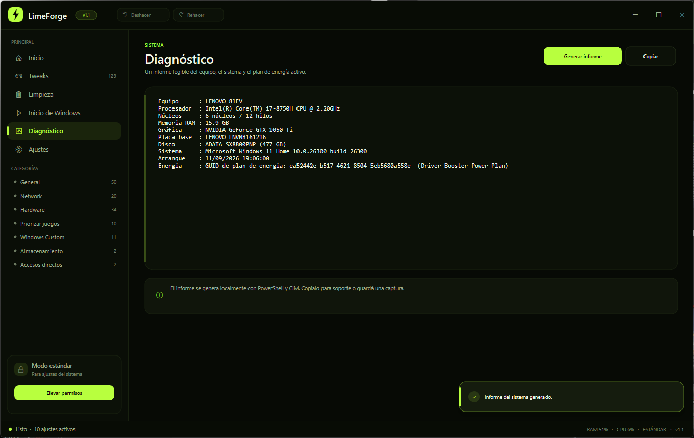
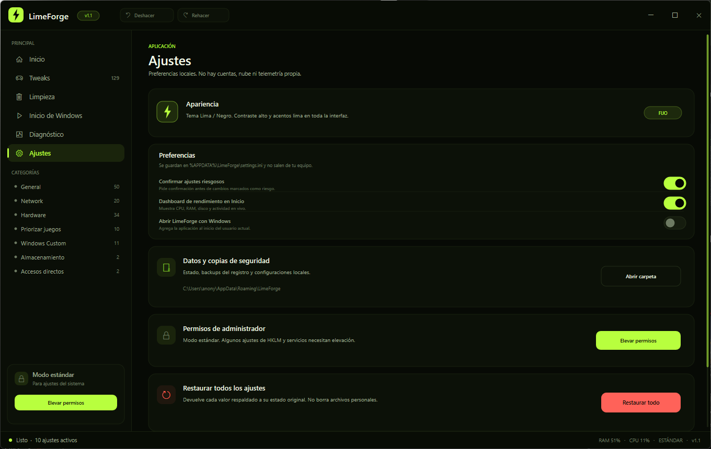

# LimeForge

Optimizador local para Windows escrito en **C++20** con **Win32**, **Direct2D** y **DirectWrite**. Interfaz frameless con tema **lima / negro**, sin cuentas, sin login, sin telemetría propia y sin servicios remotos.

LimeForge es una reimplementación independiente inspirada en la estructura de CeitoTweaks. No reutiliza su código, sus binarios ni sus recursos gráficos; las operaciones de sistema se implementaron desde cero sobre las APIs de Windows.



## Características

- **117 tweaks reales** organizados en 7 categorías:
  - General — 42
  - Network — 20
  - Hardware — 33
  - Priorizar juegos — 10
  - Windows Custom — 9
  - Almacenamiento — 2
  - Accesos directos — 1
- **Aplicar y revertir** con copia previa de cada valor del registro.
- **Pack recomendado** de 27 ajustes seguros y reversibles.
- **Limpieza**: temporales, papelera, caché DNS, cachés de navegadores, Windows Update, Prefetch y registros de eventos.
- **Inicio de Windows**: lectura de entradas de usuario y sistema, acceso al Administrador de tareas y a la carpeta Inicio.
- **Diagnóstico**: informe local de equipo, CPU, RAM, GPU, placa base, disco, sistema, arranque y plan de energía activo.
- **Ajustes**: carpeta de datos, elevación de permisos, restauración global y estado de la aplicación.
- **Prioridad de juegos**: reglas por proceso y watcher local para Roblox, Fortnite, CS2, League of Legends y Minecraft.
- **Búsqueda y filtros** por estado, recomendados, riesgosos y acciones.
- **Confirmaciones** para ajustes riesgosos, avisos de portátil y acciones destructivas.
- **Elevación UAC** mediante `ShellExecuteW("runas")`.
- Estado y copias de seguridad **100 % locales** en `%APPDATA%\LimeForge`.

| Tweaks (maximizado) | Limpieza |
| --- | --- |
|  |  |

| Detalle | Confirmación |
| --- | --- |
|  |  |

| Diagnóstico | Ajustes |
| --- | --- |
|  |  |

## Estructura

```text
LimeForge/
├─ assets/
│  └─ icon.ico                 Icono generado para LimeForge
├─ docs/screenshots/           Capturas de la aplicación
├─ src/
│  ├─ app.cpp / app.h          Interfaz Direct2D, vistas, modales, input
│  ├─ catalog.h                Tipos Tweak / RegOp
│  ├─ catalog_data.cpp         Catálogo generado de 117 tweaks
│  ├─ engine.cpp / engine.h    Registro, PowerShell, backups, limpieza,
│  │                          diagnóstico, inicio y prioridad de juegos
│  ├─ main.cpp                 WinMain, ventana frameless, DPI, mensajes
│  ├─ theme.h                  Paleta lima / negro
│  ├─ app.rc / app.manifest    Icono, manifiesto y versión
│  └─ resource.h
├─ tools/
│  └─ generate_catalog.js      Generador del catálogo y sus operaciones
├─ LimeForge.exe               Binario Release listo para ejecutar
└─ CMakeLists.txt
```

## Requisitos de compilación

- Windows 10 1809 o superior / Windows 11
- Visual Studio con **Desktop development with C++** (probado con VS 18 Community, MSVC 19.51)
- CMake 3.24 o superior
- Ninja (incluido con Visual Studio)

## Compilar

El generador de Visual Studio puede no detectar una instalación no registrada. El proyecto se compila de forma reproducible con `vcvars64.bat` + Ninja:

```bat
call "C:\Program Files\Microsoft Visual Studio\18\Community\VC\Auxiliary\Build\vcvars64.bat"
"C:\Program Files\CMake\bin\cmake.exe" -S . -B build-ninja -G Ninja -DCMAKE_BUILD_TYPE=Release
"C:\Program Files\CMake\bin\cmake.exe" --build build-ninja
```

El ejecutable queda en `build-ninja\LimeForge.exe`. La copia de la raíz se genera con:

```powershell
Copy-Item .\build-ninja\LimeForge.exe .\LimeForge.exe -Force
```

> Ajustá las rutas si Visual Studio o CMake están instalados en otra ubicación. También podés abrir el proyecto con el generador de Visual Studio si tu instalación está registrada.

## Ejecutar

```powershell
.\LimeForge.exe
```

La aplicación solicita elevación solo cuando se usa **Elevar permisos** o cuando un ajuste concreto necesita HKLM, servicios o tareas programadas.

## Datos locales

| Archivo | Contenido |
| --- | --- |
| `%APPDATA%\LimeForge\state.ini` | IDs de tweaks aplicados |
| `%APPDATA%\LimeForge\backups.ini` | Tipo, datos y existencia original de cada valor del registro |
| `%APPDATA%\LimeForge\settings.ini` | Preferencias locales de la aplicación |

Cada valor se respalda **antes** de modificarse. Al revertir se restaura el valor original; si no existía, se elimina. Las acciones de PowerShell, planes de energía y reglas de prioridad usan comandos de reversión propios.

## Atajos

- `Ctrl+1…6`: navegar entre Inicio, Tweaks, Limpieza, Inicio de Windows, Diagnóstico y Ajustes.
- `Ctrl+F`: enfocar la búsqueda.
- `Esc`: cerrar modal o salir de la búsqueda.
- `Flechas`/rueda: desplazamiento vertical.

## Notas de seguridad

- Los cambios se aplican bajo tu responsabilidad. Creá un punto de restauración antes de modificaciones importantes.
- Algunos ajustes muestran advertencias por hardware, portátiles, seguridad o cambios difíciles de deshacer.
- Los elementos marcados como **Admin** requieren elevación.
- La app no incluye cuentas, licencias, compras, telemetría propia ni conexión a servidores de LimeForge.
- Los enlaces a drivers y utilidades de terceros abren sus sitios oficiales; LimeForge no descarga ni ejecuta binarios automáticamente.

## Verificación realizada

- Compilación Release sin errores con MSVC 19.51.36231 / C++20 / `/W4`.
- Inicio de la ventana frameless y render Direct2D/DirectWrite.
- Navegación por las seis vistas y filtros por categoría.
- Búsqueda en vivo y atajos de teclado.
- Aplicación y reversión de tweaks HKCU con creación y eliminación de backups.
- Limpieza de caché DNS con confirmación visual.
- Lectura de entradas de inicio.
- Generación de informe de diagnóstico con PowerShell/CIM.
- Modales de detalle, confirmación, elevación y pack.
- Layout a 1024×700, 1360×860 y maximizado.

discord : https://discord.gg/mSzUb2rr8Z
